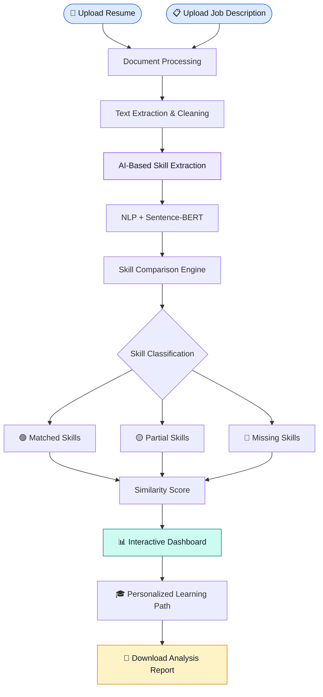

# ✨ AI POWERED SKILL GAP ANALYZER
<h3 align="center">🚀 Turn Your Skill Gaps Into Career Opportunities</h3>

<p align="center">
  
  
  
  
  
</p>

<p align="center">
  <b>An intelligent platform that connects your current capabilities with your dream career through AI-powered skill analysis and personalized learning recommendations.</b>
</p>

<p align="center">
  <a href="#-overview">Overview</a> •
  <a href="#-features">Features</a> •
  <a href="#-technology-stack">Tech Stack</a> •
  <a href="#-workflow">Workflow</a> •
  <a href="#-installation">Installation</a> •
  <a href="#-future-enhancements">Future Scope</a>
</p>

---

## 🌐 01 | PROJECT OVERVIEW

<table>
<tr>
<td width="65%">

### 🎯 What is Skill Gap Analyzer?

The **AI Powered Skill Gap Analyzer** is an intelligent web application that evaluates how well a candidate's resume matches a target job description.

Powered by Natural Language Processing, Machine Learning, and Sentence-BERT embeddings, the system identifies:

- 🟢 Skills that match job requirements.
- 🟡 Skills with partial similarities.
- 🔴 Missing or insufficient skills.
- 📊 Overall resume-job compatibility.

It goes beyond traditional keyword matching by understanding the semantic relationships between skills.

</td>
<td width="35%" align="center">


<br/><br/>

### 🧠 AI + NLP

### 📊 Smart Analytics

### 🎓 Career Guidance

### 🚀 Skill Development

</td>
</tr>
</table>

> **Our Mission:** Transform the way candidates prepare for careers by turning skill gaps into actionable learning opportunities.

---

## 🧭 02 | EXPLORE THE PLATFORM

<details open>
<summary><b>📂 Navigate Through Project Modules</b></summary>

| Module | Description |
|:---|:---|
| 📄 Document Processing | Upload and extract resume and job description content |
| 🧠 AI Skill Extraction | Automatically identify technical and soft skills |
| 🎯 Skill Gap Analyzer | Compare candidate skills with job requirements |
| 📊 Analytics Dashboard | Explore visual reports and similarity scores |
| 🔥 Semantic Heatmap | Understand relationships between skills |
| 🎓 Learning Roadmap | Discover personalized learning recommendations |
| 📑 Report Generator | Export analysis results in multiple formats |

</details>

---

## ⚡ 03 | KEY FEATURES

<table>
<tr>
<td width="50%" valign="top">

### 📄 Smart Document Processing

- Multiple resume uploads.
- PDF, DOCX and TXT support.
- Automatic text extraction.
- Text cleaning and preprocessing.
- OCR support for scanned documents.

</td>
<td width="50%" valign="top">

### 🧠 AI-Based Skill Extraction

- spaCy NLP processing.
- Sentence-BERT embeddings.
- Technical skill recognition.
- Soft skill identification.
- Fuzzy and keyword matching.

</td>
</tr>
<tr>
<td width="50%" valign="top">

### 🎯 Intelligent Gap Analysis

- Matched skill identification.
- Partial skill matching.
- Missing skill detection.
- Semantic similarity calculation.
- Resume-job compatibility score.

</td>
<td width="50%" valign="top">

### 📊 Interactive Analytics

- Processing summary dashboard.
- Skill gap pie chart.
- Category radar chart.
- Skill similarity heatmap.
- Interactive Plotly visualizations.

</td>
</tr>
<tr>
<td width="50%" valign="top">

### 🎓 Personalized Learning Path

- Priority-based recommendations.
- Difficulty classification.
- Estimated learning duration.
- Curated learning resources.
- Skill improvement guidance.

</td>
<td width="50%" valign="top">

### 📑 Smart Report Generation

- PDF report generation.
- CSV data export.
- TXT report export.
- JSON structured output.
- Downloadable analysis results.

</td>
</tr>
</table>

---

## 🛠️ 04 | TECHNOLOGY STACK

<p align="center"><b>Built using modern AI, NLP and data visualization technologies.</b></p>

### 💻 Programming & Interface

<p>


</p>

### 🧠 Artificial Intelligence & NLP

<p>


</p>

### 📊 Data Processing & Visualization

<p>


</p>

### 📁 Document Processing & Reporting

<p>


</p>

---

## 🔄 05 | SYSTEM WORKFLOW

<p align="center"><b>From Resume Upload to Personalized Career Roadmap</b></p>



---

## 📊 06 | INTERACTIVE ANALYTICS

The platform transforms extracted information into easy-to-understand visual insights.

<table>
<tr>
<th>📈 Visualization</th>
<th>💡 Purpose</th>
</tr>
<tr>
<td><b>Processing Dashboard</b></td>
<td>Displays total documents, successful processing and failures.</td>
</tr>
<tr>
<td><b>Skill Gap Pie Chart</b></td>
<td>Shows the proportion of matched and missing skills.</td>
</tr>
<tr>
<td><b>Category Radar Chart</b></td>
<td>Compares skill coverage across different domains.</td>
</tr>
<tr>
<td><b>Similarity Heatmap</b></td>
<td>Displays semantic similarity scores between skills.</td>
</tr>
<tr>
<td><b>Learning Recommendations</b></td>
<td>Displays prioritized skills, estimated durations and resources.</td>
</tr>
</table>

---

## 🖼️ 07 | APPLICATION SHOWCASE

<p align="center"><b>Explore the major application screens</b></p>

> Replace the image paths below with screenshots captured from your actual application.

<table>
<tr>
<td align="center" width="50%">

### 📤 Document Upload


<sub>Resume and job description upload interface</sub>

</td>
<td align="center" width="50%">

### 🎯 Skill Gap Analysis


<sub>Matched, partially matched and missing skills</sub>

</td>
</tr>
<tr>
<td align="center" width="50%">

### 📊 Analytics Dashboard


<sub>Interactive charts and similarity analysis</sub>

</td>
<td align="center" width="50%">

### 🎓 Learning Roadmap


<sub>Personalized learning recommendations</sub>

</td>
</tr>
</table>

---

## 🚀 08 | INSTALLATION & EXECUTION

<details>
<summary><b>STEP 01 — Clone the Repository</b></summary>

```bash
git clone YOUR_GITHUB_REPOSITORY_URL
```

</details>

<details>
<summary><b>STEP 02 — Navigate to Project Directory</b></summary>

```bash
cd AI-Powered-Skill-Gap-Analyzer
```

</details>

<details>
<summary><b>STEP 03 — Create Virtual Environment</b></summary>

```bash
python -m venv venv
```

</details>

<details>
<summary><b>STEP 04 — Activate Virtual Environment</b></summary>

**Windows**

```bash
venv\Scripts\activate
```

**Linux / macOS**

```bash
source venv/bin/activate
```

</details>

<details>
<summary><b>STEP 05 — Install Dependencies</b></summary>

```bash
pip install -r requirements.txt
```

</details>

<details>
<summary><b>STEP 06 — Download spaCy Language Model</b></summary>

```bash
python -m spacy download en_core_web_sm
```

</details>

<details>
<summary><b>STEP 07 — Launch Application</b></summary>

```bash
streamlit run app.py
```

</details>

<p align="center">
  
</p>

---

## 🌍 09 | REAL-WORLD APPLICATIONS

| 👥 Users | 🚀 Benefits |
|:---|:---|
| 🎓 Students | Identify placement preparation gaps |
| 💼 Job Seekers | Improve resume compatibility |
| 🏢 Recruiters | Compare candidates against job requirements |
| 👩‍💻 HR Teams | Identify employee training needs |
| 📚 Learning Platforms | Recommend relevant courses |

---

## 🔮 10 | FUTURE ENHANCEMENTS

- 🔗 LinkedIn profile integration.
- 🤖 AI-powered resume improvement suggestions.
- 🌐 Multi-industry skill analysis.
- 📈 Career trend analysis and recommendations.
- 🎓 Live course and certification integration.
- 📊 Continuous skill progress tracking.
- 💬 AI career guidance chatbot.

---

## 🏆 11 | PROJECT IMPACT

<table>
<tr>
<td align="center" width="33%">
<h2>🧠</h2>
<b>Intelligent Analysis</b>
<br/>
<sub>AI-powered skill identification</sub>
</td>
<td align="center" width="33%">
<h2>📊</h2>
<b>Smart Insights</b>
<br/>
<sub>Data-driven skill comparison</sub>
</td>
<td align="center" width="33%">
<h2>🎓</h2>
<b>Career Growth</b>
<br/>
<sub>Personalized learning guidance</sub>
</td>
</tr>
</table>

**AI Powered Skill Gap Analyzer** bridges the gap between candidate capabilities and industry expectations by combining intelligent document processing, semantic understanding and personalized learning recommendations.

<p align="center">
  <b>Don't Just Find Your Skill Gaps. Bridge Them. 🚀</b>
</p>

---

## 👩‍💻 12 | DEVELOPED WITH

<p align="center">
  
  
  
</p>

<p align="center">
  ⭐ If you find this project useful, don't forget to star the repository!
</p>

<p align="center">
  <i>Empowering Talent. Identifying Potential. Building Careers.</i>
</p>
